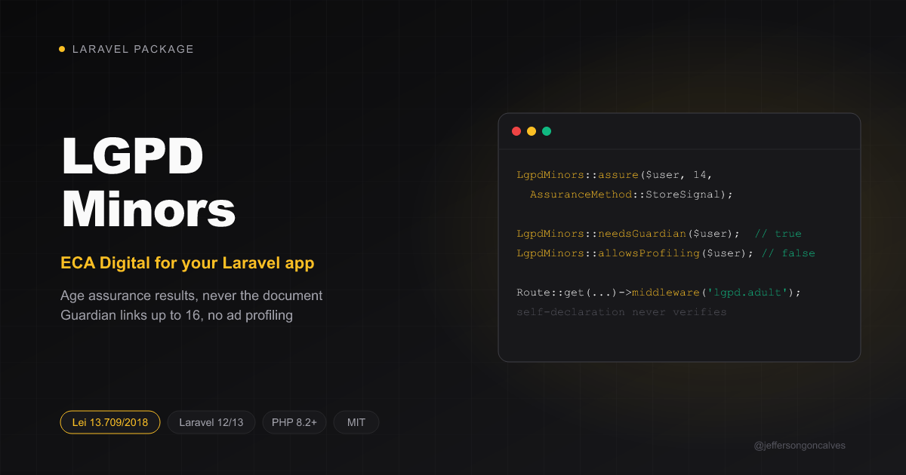

# Laravel LGPD Minors



[](https://packagist.org/packages/jeffersongoncalves/laravel-lgpd-minors)
[](https://github.com/jeffersongoncalves/laravel-lgpd-minors/actions/workflows/tests.yml)
[](https://packagist.org/packages/jeffersongoncalves/laravel-lgpd-minors)

Building blocks for Brazil's Digital Statute of Children and Adolescents, known as **ECA Digital** (Lei 15.211/2025, regulated by Decreto 12.880/2026). It applies to digital products directed to children and adolescents, or likely to be used by them. It is part of the [laravel-lgpd](https://github.com/jeffersongoncalves/laravel-lgpd) suite.

- **Age assurance results only:** you store the age band, the method and the provider. The document, selfie or birth date used to reach it is never stored, and the result is only used to protect the user (art. 13).
- **One age band per user:** reliable checks outweigh self-declaration. When reliable checks disagree, the most protective band wins (Decreto, art. 25, §4). Results expire, so users are checked again as they grow up.
- **Adult-only routes:** the `lgpd.adult` middleware checks for a reliable adult result on every request. Self-declaration is never enough (art. 9, §1).
- **Guardians:** accounts of users up to 16 must be linked to a legal guardian (art. 24). Without one, the user cannot lower the protective defaults (§5).
- **Suspension with appeal:** suspend an account when there are well-founded signs that a minor is using it outside the rules, then take the appeal and decide it (§4).
- **No ad profiling for minors:** `allowsProfiling()` and `@lgpdProfiling` only let verified adults through (arts. 22 and 26).

> This package gives you tooling. It does not make you compliant on its own. ECA Digital also covers protective design, anti-compulsive-use features, parental supervision tools, loot boxes, content reporting and transparency reports. The ANPD's guide on age assurance mechanisms is still being finalised. Your product needs legal review.

## Installation

```bash
composer require jeffersongoncalves/laravel-lgpd-minors
php artisan vendor:publish --tag="lgpd-minors-migrations"
php artisan migrate
php artisan vendor:publish --tag="lgpd-minors-config"   # optional
```

## Usage

### Recording age checks

```php
use JeffersonGoncalves\LgpdMinors\Enums\AgeBand;
use JeffersonGoncalves\LgpdMinors\Enums\AssuranceMethod;
use JeffersonGoncalves\LgpdMinors\Facades\LgpdMinors;

LgpdMinors::assure($user, 14, AssuranceMethod::StoreSignal);                 // an age, turned into a band
LgpdMinors::assure($user, AgeBand::Adult, AssuranceMethod::Document, 'acme-id');

LgpdMinors::band($user);             // AgeBand::YoungAdolescent: the most protective reliable result
LgpdMinors::isVerifiedAdult($user);  // false
LgpdMinors::treatAsMinor($user);     // true
```

| Band | Ages | Guardian required |
|---|---|---|
| `child` | under 12 | yes |
| `young_adolescent` | 12 to 16 | yes |
| `adolescent` | 17 | no |
| `adult` | 18+ | no |
| `unknown` | no valid result | no, but see `likely_access` |

The methods are `self_declaration`, `os_signal`, `store_signal`, `document`, `facial_estimation`, `verifiable_credential` and `guardian`. You choose which ones count as reliable in `reliable_methods`, and how long each one is valid in `valid_for`. Self-declaration never counts as reliable.

If the user has at least one reliable result, only the reliable results count. If not, the self-declared results count. A user with no valid result is `unknown`. When `likely_access` is true (the default), `treatAsMinor()` treats unknown users as minors.

### Adult-only content

```php
Route::get('/store/adult', AdultStoreController::class)->middleware(['auth', 'lgpd.adult']);
```

Users without a reliable adult result get a 403. To send them to your verification page instead, set `verify_route` to that route's name.

### Guardians

```php
$link = LgpdMinors::link($child, $mother, 'mother');  // pending until you verify the guardian
$link->verify();

LgpdMinors::needsGuardian($child);       // false once a verified link exists
LgpdMinors::guardians($child);           // Collection of guardian models
LgpdMinors::canLowerProtection($child);  // check before letting the user make the profile public, enable location...

$link->revoke();
```

### Suspension and appeal

```php
$suspension = LgpdMinors::suspend($user, 'Profile photos suggest a 10-year-old.');

Route::middleware(['auth', 'lgpd.suspended'])->group(...);  // 403 while suspended; leave your appeal route outside

$suspension->appeal('I am 19, see my document.');
$suspension->lift('Document checked.');   // or ->uphold('Confirmed.')
```

An upheld suspension stays in force. A lifted one no longer blocks the account.

### Ads and tracking

```blade
@lgpdProfiling
    <script src="https://ads.example.com/pixel.js"></script>
@endlgpdProfiling
```

```php
if (LgpdMinors::allowsProfiling($user)) {
    // send behavioural events to your ad platform
}
```

### Report

```bash
php artisan lgpd:minors          # users up to 16 without a guardian, appeals waiting for a decision
php artisan lgpd:minors --json
```

The command exits with 1 when something needs attention, so you can schedule it and alert on failure.

## Testing

```bash
composer test
```

## Changelog

See [CHANGELOG](CHANGELOG.md).

## License

The MIT License (MIT). See [License File](LICENSE.md).
